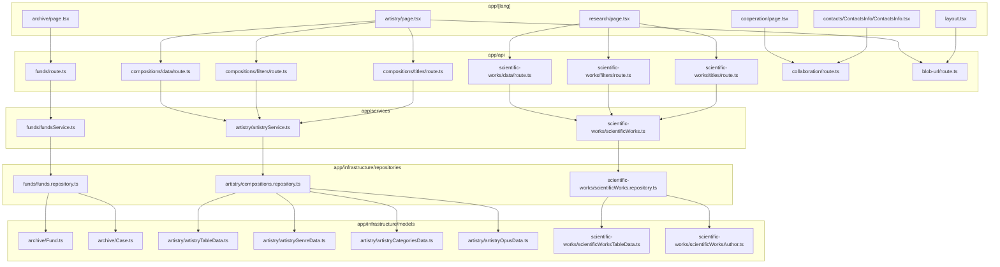

Діаграма показує, як сторінки в `app/[lang]/` звертаються до маршрутів у `app/api/`, які маршрути резолвлять сервіси з `app/services/` через контейнер `app/di/` (`container.ts`, `modules/composedServices.module.ts`, `modules/repositories.module.ts`), і від яких репозиторіїв та моделей у `app/infrastructure/` ці сервіси залежать. Вузли підписані реальними папками й файлами. Маршрути `collaboration/route.ts` і `blob-url/route.ts` не ходять у сервіси й базу: перший лише валідує тіло запиту, другий віддає файли з `public/`.

