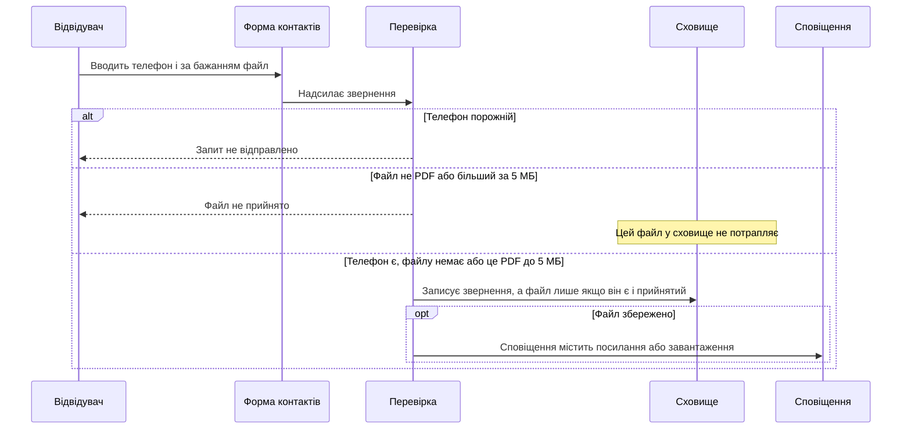

# Контактна форма: телефон і файл

## 1. Короткий опис і вихідний запит

Відвідувач на сторінці контактів (`/contacts`) залишає ім’я, електронну пошту, телефон і повідомлення та ставить згоду з політикою конфіденційності. Телефон зараз можна не заповнювати. Поля для файлу немає. Сторінка надсилає дані на `/api/collaboration`. Маршрут `/api/contact` ніде на сайті не викликається. Обидва маршрути лише перевіряють дані і повертають успіх: у базу не пишуть і листа не надсилають.

Вихідний запит з [issue #2](https://github.com/moskvaolena04-jpg/sdd-workshop-olena/issues/2):

> ## Original request
> We want to tighten up the contact form. Phone number should be mandatory.
> We should also let visitors attach a document (CV or portfolio) when they write
> to us. Notifications need to reflect the new field.

Пізніше для розробки зафіксовано три зміни: телефон обов’язковий; необов’язковий файл лише PDF до 5 МБ; у сповіщенні вкладення як посилання або завантаження.

## 2. Бізнес-контекст

**Підтверджено замовником.** Зробити вже наявний телефон обов’язковим: зараз порожнє поле форма приймає, після зміни порожній номер не відправляється. Додати необов’язковий файл резюме. Файл лише PDF і не більший за 5 МБ, телефон і файл зберігаються тільки в базі даних, читати їх можуть лише 2 працівники, запис зберігається 6 місяців. Обов’язковий телефон зафіксовано у вихідному запиті. Файл PDF, межа 5 МБ, строк 6 місяців і доступ двох працівників виплили з розмови із замовником.
<!-- edited: телефон на формі вже є, його не додають як нове поле -->

**Припущення.** Якщо номер введено, перевірка формату лишається такою, як система працює вже зараз. Форма перевіряє код країни і довжину: номер не коротший за мінімум цієї країни і не довший за 16 цифр. Невідомий код країни або текст без цифр не проходить. Форма показує «Перевірте формат номера телефону» / «Check the phone number format» і не відправляє звернення. Номер, що починається з 0, форма перетворює на український: попереду додає 38. Сервер перевіряє номер лише коли його передали: рядок із «+» і цифр, від 11 до 16 символів. Інакше відповідь містить «Invalid phone number». Форма рахує цифри без «+»: для Ісландії, Данії та Норвегії вистачає 10 цифр і не більше як 16. Сервер рахує весь рядок разом із «+», від 11 до 16 символів. Рівно 10 цифр дають 11 символів, і сервер їх приймає. 16 цифр дають 17 символів, і сервер їх відхиляє.

**Метрика успіху.** Кожне прийняте звернення з телефоном і PDF-файлом до 5 МБ є в базі, його можуть відкрити лише 2 призначені працівники, і запис не зберігається довше за 6 місяців. Файл іншого типу або більший за 5 МБ у базу не потрапляє.

**Обмеження.** Це теж підтверджено замовником.

- NFR-01. Телефон і файл цього звернення записуються лише в базу даних.
- NFR-02. Читати збережені звернення можуть лише 2 працівники.
- NFR-03. Запис зберігається 6 місяців.

Чи входить у межу файл рівно 5 МБ і де фізично лежать байти файлу, не вирішено. Це питання Q-01 і Q-08.

## 3. User stories

- Як відвідувач, я хочу обов’язково залишити телефон і за бажанням прикріпити PDF, щоб фонд міг мені відповісти і переглянути документ.
- Як фонд, я хочу тримати весь запис лише в базі, не довше ніж 6 місяців від дати збереження і лише для двох працівників, щоб доступ до звернення лишався вузьким.
<!-- edited: прибрано історію, ніби лист отримує працівник. Хто отримує сповіщення, не сказано. Див. Q-13 -->

## 4. Діаграма послідовності

Місце, куди лягають байти файлу, на діаграмі назване «сховище»: база, диск чи blob (сховище файлів за адресою) ще не вибрані. Див. Q-08.

<!-- edited: прибрано заборону вкладеного PDF. Замовник допустив посилання або завантаження -->

## 5. Таблиця правил

Три стани: як є в коді зараз, яким має стати, хто це вирішив. Порожня клітинка означає, що рішення ще немає.

| RULE-ID | Правило простою мовою | Є зараз | Має бути | Хто вирішив |
| --- | --- | --- | --- | --- |
| RULE-04 | Телефон можна не заповнювати | Так | Телефон обов’язковий | Замовник |
| RULE-05 | Якщо номер введено, форма перевіряє код країни і довжину | Так | | |
| RULE-06 | Сервер приймає лише «+» і цифри, від 11 до 16 символів, і лише коли номер уже передано | Так | | |
| RULE-08 | Помилки біля полів беруться з перекладу сторінки | Так | | |
| RULE-09 | Помилка сервера про номер англійською: «Invalid phone number» | Так | | |
| RULE-13 | Після відправки вікно «Ваш запит надіслано» / «Your request has been sent» | Так | | |
| RULE-14 | Шаблон листа містить телефон, якщо його передали. Файлу там немає. Маршрути шаблон не викликають | Так | Сповіщення показує нове поле як посилання або завантаження | Замовник |
| RULE-15 | Виклик листа нічого не надсилає | Так | | |
| RULE-16 | Відповідь API не записує звернення | Так | Дані лише в базі. Доступ після входу двох облікових записів, не через публічну адресу. Весь запис зберігається 6 місяців від дати збереження | Замовник |
| RULE-17 | Прикріпити файл не можна | Поля зараз немає | Поле має бути: можна прикріпити документ. Для резюме лише PDF до 5 МБ | Замовник |
| RULE-22 | Форма рахує цифри без «+»: для Ісландії, Данії та Норвегії вистачає 10 і не більше як 16. Сервер рахує рядок із «+»: від 11 до 16 символів. 10 цифр сервер приймає, 16 цифр відхиляє | Так | | |
| RULE-23 | Сервер збирає помилки англійським списком. Форма його не показує | Так | | |
| RULE-24 | Якщо сервер відхилив запит, відвідувач бачить лише запис у консолі | Так | | |
| RULE-28 | Сторінка контактів викликає `/api/collaboration`. Та сама форма стоїть у співпраці і у вікні нот | Так | | |
| RULE-30 | Телефон у словах замовника описаний двічі: обов’язковий номер і поле без перевірки | Так, у розмові | Обов’язковість вирішена. Перевірка формату лишається припущенням: як система працює зараз. | |

<!-- edited: з «Має бути» прибрано невирішене: точні тексти помилок і те, що лист створюється на кожне звернення -->

## 6. Критерії приймання

- **AC-01**
  - Given українська мова, ім’я «Олена», пошта «o@example.com», повідомлення «Хочу долучитися», згода стоїть, телефон порожній
  - When відвідувач надсилає форму
  - Then запит не відправлено
  - Rules: RULE-04, RULE-30
- **AC-04**
  - Given ім’я «Олена», пошта «o@example.com», повідомлення «Хочу долучитися», номера телефону в запиті немає
  - When сервер перевіряє звернення
  - Then відповідь не успішна
  - Rules: RULE-04
- **AC-07**
  - Given телефон «+380000000000», згода стоїть, прикріплено PDF розміром 5 МБ
  - When відвідувач надсилає форму
  - Then цей файл є в базі
  - Rules: RULE-16, RULE-17
- **AC-08**
  - Given PDF розміром 5 МБ збережено
  - When сформовано сповіщення
  - Then у сповіщенні є посилання або завантаження цього файлу
  - Rules: RULE-14, RULE-17
- **AC-09**
  - Given телефон «+380000000000», згода стоїть, прикріплено PDF розміром 5 МБ і 1 байт
  - When відвідувач надсилає форму
  - Then цього файлу в базі немає
  - Rules: RULE-17
- **AC-12**
  - Given телефон «+380000000000», згода стоїть, прикріплено файл PNG
  - When відвідувач надсилає форму
  - Then цього файлу в базі немає
  - Rules: RULE-17
- **AC-15**
  - Given телефон «+380000000000», згода стоїть, поле файлу порожнє
  - When відвідувач надсилає форму
  - Then поле файлу без стану помилки
  - Rules: RULE-17
- **AC-18**
  - Given файл резюме збережено
  - When минуло 6 місяців від дати збереження запису
  - Then цього запису в базі немає
  - Rules: RULE-16
- **AC-19**
  - Given файл резюме збережено
  - When його відкриває користувач, якому не надано доступ
  - Then файл не відкривається
  - Rules: RULE-16
<!-- edited: знято AC-02, AC-03, AC-05, AC-06, AC-10, AC-11, AC-13, AC-14, AC-16, AC-17 і AC-20. Точні тексти помилок, зірочка в підписі, відкриття посилання і лист без файлу не були задані -->

## 7. Ключові файли

| Файл | Навіщо він у цій фічі |
| --- | --- |
| `app/shared/components/forms/contact-form/ContactForm.tsx` | Поля форми, перевірка на екрані, вікно після відправки |
| `app/shared/components/forms/offer-collaboration-form/OfferCollaborationForm.tsx` | Надсилає форму контактів на `/api/collaboration` |
| `app/[lang]/contacts/ContactsInfo/ContactsInfo.tsx` | Ставить цю форму на сторінку контактів |
| `app/shared/components/get-notes-modal/GetNotesModal.tsx` | Та сама форма у вікні нот, без запиту на сервер |
| `app/lib/utils/validateContactData.ts` | Серверна перевірка імені, пошти, телефону і повідомлення |
| `app/constants/validation.ts` | Межі довжини і шаблон телефону |
| `app/constants/errors.ts` | Англійські тексти серверних помилок |
| `app/api/contact/route.ts` | Маршрут контакту. Сайт його не викликає |
| `app/api/collaboration/route.ts` | Маршрут, який викликає сторінка контактів |
| `app/services/email/emails/emails.ts` | Шаблон листа. Файлу в ньому немає |
| `app/services/email/emailService.ts` | Збирає лист і не відправляє його |
| `app/services/upload/upload.ts` | Завантаження файлу нічого не зберігає |
| `app/validators/blob.schema.ts` | Список типів файлів, серед них PDF. Список ніде не підключений |
| `app/api/blob-url/route.ts` | Віддає вже покладений файл за адресою. Папки для резюме немає |
| `i18n/messages/uk.json`, `i18n/messages/en.json` | Підписи форми і тексти помилок |

## 8. Відкриті питання

- **Q-01.** Підтвердити припущення, що PDF розміром рівно 5 МБ приймається? AC-07 приймає такий файл, AC-09 відхиляє файл на 1 байт більший. Відповідає замовник.
- **Q-03.** Форма рахує цифри без «+» і для Ісландії, Данії та Норвегії приймає від 10 до 16 цифр. Сервер рахує весь рядок разом із «+», від 11 до 16 символів. 10 цифр проходять, 16 цифр форма відправляє, а сервер відхиляє. Яка верхня межа єдина: 16 цифр чи 16 символів разом із «+»? Відповідає замовник.
- **Q-04.** Які точні тексти показувати українською і англійською, якщо телефон порожній, файл не PDF або файл більший за 5 МБ? Готових рядків для цього немає. Від цього залежить, що написано біля поля. Відповідає редактор текстів.
- **Q-05.** Помилка сервера лишається англійською («Invalid phone number») чи теж залежить від мови сторінки? Від цього залежить, що показувати відвідувачу. Відповідає редактор текстів.
- **Q-06.** Що бачить відвідувач, якщо форма номер пропустила, а сервер звернення відхилив? Зараз це лише запис у консолі. Від цього залежить екран відмови. Відповідає власник сторінки контактів.
- **Q-07.** Якщо файл не зберігся або сповіщення не створилося, звернення скасовується чи лишається частинами? Від цього залежить, що вважати успіхом в AC-07 і AC-08. Відповідає замовник.
- **Q-08.** Де лежать байти файлу: у базі, на диску, у blob-сховищі (сховище файлів за адресою) чи ніде, крім посилання або завантаження? Від цього залежить, куди писати файл. Завантаження зараз нічого не зберігає. Відповідає замовник.
- **Q-10.** Хто саме ці два працівники і як їм дають доступ? Від цього залежить перевірка AC-19. Відповідає керівник фонду.
- **Q-12.** Обов’язковий телефон і файл стосуються лише сторінки контактів чи також форми співпраці і вікна нот? Сторінка контактів викликає `/api/collaboration`, а не `/api/contact`. Від цього залежить, який маршрут прийматиме файл і чи змінювати спільну форму. Відповідає власник сторінки контактів.
- **Q-13.** Хто отримує сповіщення про нове поле? Від цього залежить, кому показувати телефон і файл. Відповідає замовник.
- **Q-14.** Чи покриває вже наявний прапорець «Я даю згоду на обробку моїх персональних даних та погоджуюся з Політикою конфіденційності» зберігання телефону і PDF-резюме протягом 6 місяців із доступом лише двох працівників, чи перед збереженням треба змінити текст прапорця і політику, щоб там були ці дані, строк і хто їх читає? Від цього залежить, чи можна зберігати телефон і файл із поточною згодою. Відповідає замовник.
<!-- edited: Q-02, Q-09 і Q-11 закриті. Питання про згоду перенесено в Q-14 -->
