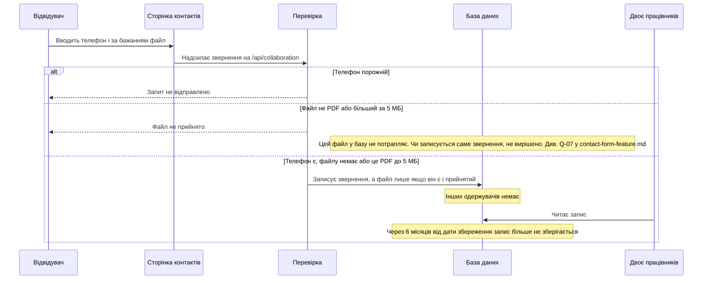

# Оновлення сторінки контактів

## Короткий опис

Відвідувач на сторінці контактів (`/contacts`) залишає звернення. Зараз форма просить ім’я, електронну пошту, телефон і повідомлення. Телефон можна не заповнювати. Якщо номер введено, форма перевіряє код країни і довжину, а сервер приймає лише «+» і цифри, від 11 до 16 символів, і лише коли номер уже передано. Форма рахує цифри без «+»: для Ісландії, Данії, Норвегії та Сингапуру вистачає 10 цифр. Сервер рахує весь рядок разом із «+». Сторінка надсилає дані на `/api/collaboration`. Маршрут `/api/contact` ніде на сайті не викликається. Обидва маршрути лише перевіряють дані і повертають успіх. У базу ці дані не записуються.

**Ціль.** Зробити вже наявний телефон обов’язковим: порожній номер не відправляється. Додати необов’язковий файл резюме (CV, curriculum vitae). Якщо файл прикріплено, він приймається лише як PDF і не більший за 5 МБ. Телефон і файл зберігаються тільки в базі даних. Читати їх можуть лише 2 працівники. Весь запис зберігається 6 місяців від дати збереження.

**Припущення.** Якщо номер введено, перевірка формату лишається такою, як система працює вже зараз. Форма рахує цифри без «+»: для Ісландії, Данії, Норвегії та Сингапуру вистачає 10 цифр і не більше як 16. Сервер рахує весь рядок разом із «+», від 11 до 16 символів. Рівно 10 цифр дають 11 символів, і сервер їх приймає. 16 цифр дають 17 символів, і сервер їх відхиляє.

Чи входить у межу файл рівно 5 МБ, не вирішено. Це питання Q-06.

**Метрика успіху.** Кожне прийняте звернення з телефоном і PDF-файлом до 5 МБ є в базі, його можуть відкрити лише 2 призначені працівники, і запис не зберігається довше за 6 місяців від дати збереження. Файл іншого типу або більший за 5 МБ у базу не потрапляє.

## User stories

- Як відвідувач, я хочу обов’язково залишити телефон і за бажанням прикріпити резюме у PDF, щоб фонд міг зі мною зв’язатися і переглянути мій досвід.
- Як один із двох працівників фонду, я хочу бачити збережений телефон і резюме, якщо його прикріпили, щоб опрацювати звернення.
- Як фонд, я хочу тримати весь запис лише в базі, не довше ніж 6 місяців від дати збереження і лише для двох працівників, щоб доступ до звернення лишався вузьким.

## Потік даних

Так має працювати нова форма. Сторінка контактів викликає `/api/collaboration`. Цей маршрут до бази не доходить. `/api/contact` сайт не викликає.

## Правила

| ID | Правило | Що бачить людина, якщо правило не виконане |
| --- | --- | --- |
| BR-01 | Телефон уже є на формі. Порожній номер не відправляється | Запит не відправлено |
| BR-02 | Файл резюме необов’язковий. Якщо його прикріплено, це PDF | Файл не зберігається |
| BR-03 | Розмір файлу не більший за 5 МБ | Файл не зберігається |
| BR-04 | Якщо номер введено, перевірка лишається припущенням: як система працює зараз. Форма рахує цифри без «+»: для Ісландії, Данії, Норвегії та Сингапуру вистачає 10 і не більше як 16. Сервер рахує рядок із «+»: від 11 до 16 символів | Зараз форма показує помилку формату. Новий текст не заданий |
| NFR-01 | Телефон і файл цього звернення записуються лише в базу даних | Дані не потрапляють в інше місце зберігання |
| NFR-02 | Читати збережені звернення можуть лише 2 працівники | Інші люди ці записи не відкривають |
| NFR-03 | Весь запис зберігається 6 місяців від дати збереження | Після цього строку запису в базі немає |

## Acceptance Criteria

- **AC-01**
  - Given українська мова, ім’я «Олена», пошта «o@example.com», повідомлення «Хочу долучитися», згода стоїть, телефон порожній
  - When відвідувач надсилає форму
  - Then запит не відправлено
- **AC-02**
  - Given відвідувач прикріпив файл PDF розміром 5 МБ
  - When він надсилає форму
  - Then файл записаний у базу
- **AC-03**
  - Given відвідувач прикріпив файл не у форматі PDF або PDF більший за 5 МБ
  - When він надсилає форму
  - Then цей файл у базі відсутній
- **AC-04**
  - Given звернення вже лежить у базі
  - When його відкриває хтось, крім двох призначених працівників
  - Then ця людина запис не бачить
- **AC-05**
  - Given звернення збережено в базі
  - When минуло 6 місяців від дати збереження запису
  - Then запис у базі більше не зберігається
- **AC-06**
  - Given ім’я «Олена», пошта «o@example.com», повідомлення «Хочу долучитися», номера телефону в запиті немає
  - When сервер перевіряє звернення
  - Then відповідь не успішна

## Ключові файли

| Файл | Навіщо він у цій фічі |
| --- | --- |
| `app/[lang]/contacts/page.tsx` | Маршрут сторінки контактів |
| `app/[lang]/contacts/ContactsInfo/ContactsInfo.tsx` | Блок сторінки, де стоїть форма |
| `app/shared/components/forms/contact-form/ContactForm.tsx` | Поточна форма. У ній уже є телефон, і його можна не заповнювати |
| `app/shared/components/forms/offer-collaboration-form/OfferCollaborationForm.tsx` | Надсилає форму контактів на `/api/collaboration` |
| `app/api/collaboration/route.ts` | Маршрут, який викликає сторінка контактів. Він перевіряє дані і не записує їх у базу |
| `app/api/contact/route.ts` | Маршрут контакту. Сайт його не викликає |

## Відкриті питання

- **Q-03.** Хто саме ці 2 працівники і як їм дають доступ? Від цього залежить, кого пускати до записів. Може відповісти керівник фонду.
- **Q-05.** Який текст показати відвідувачу, якщо файл не PDF або більший за 5 МБ? Від цього залежить повідомлення на формі. Може відповісти редактор текстів фонду.
- **Q-06.** Підтвердити припущення, що PDF розміром рівно 5 МБ приймається? AC-02 записує такий файл у базу, AC-03 відхиляє файл більший за 5 МБ. Може відповісти замовник.
<!-- Q-01, Q-02 і Q-04 закриті. Формат лишається припущенням. Файл необов’язковий. Зникає весь запис від дати збереження -->
